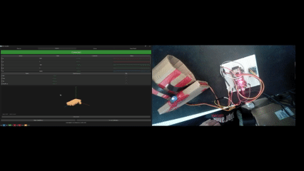
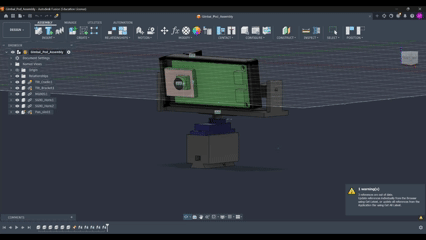

# lifeOS

**A wearable hand-motion capture rig.** The lifeOS band tracks the hand's
orientation with an IMU and streams it live to a PC that rebuilds the motion
in 3D. Next, it adds a second IMU and gimbal-mounted cameras that keep the
hand in view. It started as a
replacement for the keyboard and mouse, and that is still where it is headed.
The same captured motion can also serve as training data for robots.

<p align="center">
  
  
</p>

**Demo video:** [youtu.be/epanw58KE4c](https://youtu.be/epanw58KE4c)

## Status

| | |
| --- | --- |
| **Working** | ESP32-S3-CAM + MPU6050 streaming fused DMP quaternions over USB or Wi-Fi UDP (~50 Hz) · PC app with a live 3D hand, sensor monitor and servo control · 6-point accelerometer calibration, gyro recalibration and yaw de-drift (the MPU6050 has no magnetometer) · JPEG video from the onboard OV3660 camera over Wi-Fi |
| **In progress** | 3D-printed rig, modeled in Fusion 360, replacing the cardboard mockup |
| **Planned** | Second IMU on the forearm · calibration pose · two cameras on 2-axis gimbals · camera + IMU fusion · keyboard-and-mouse replacement and robot training data. See the [Roadmap](#roadmap). |

## How it works

An **ESP32 + MPU6050 IMU** streams fused orientation (and drives servos) to a
PC, which visualizes the motion in 3D and commands the servos back. **Two
boards are supported** (compile-time `#define` in `lifeOs.ino`, runtime Board
dropdown in the GUI):

- **ESP32-S3-CAM** (GoouuuTech, ESP32-S3-WROOM-1 **N16R8**, OV3660 camera,
  dual USB-C, microSD) — **the actively developed board.** The S3 has **no
  Bluetooth Classic**, so the feed starts on **USB serial** (the CH343 "COM"
  USB-C port) and can then be moved onto **Wi-Fi UDP** with the GUI's **Go
  wireless** button.
- **ESP-WROOM-32** — **legacy, frozen since 2026-07-08** (code kept, no longer
  developed or tested). Its sensor/servo feed is **Bluetooth Classic SPP**.

```
                 ┌────────── feed: BT SPP (WROOM-32) / USB→Wi-Fi UDP (S3) ──┐
MPU6050 ──I2C──► ESP32   sensor telemetry + servo echo  ──►  PC (PySide6 GUI)
 servos ◄─PWM──   │      ◄── servo commands + Wi-Fi provisioning ───────────┘
                 └──────────── Wi-Fi/UDP (video, on demand) ───────────────► PC
```

Either way the laptop sends its Wi-Fi SSID/password and **current IP** over the
feed link; the ESP32 joins Wi-Fi and streams high-bandwidth **video** by UDP.
Sending the laptop's IP each session means a changing DHCP address never breaks
the link, and nothing is hardcoded. On the S3, `feed:wifi` ("Go wireless")
additionally moves telemetry + servo commands onto Wi-Fi UDP so the USB cable
can be unplugged. The S3-CAM's OV3660 streams real JPEG frames (chunked
`vf:` UDP packets, viewable live in the GUI's Hand Model tab); a synthetic
frame stream remains the fallback for testing the path without a camera.

## Wire protocol

Identical bytes on every transport (BT SPP / USB serial / Wi-Fi UDP).

**Sensor telemetry, one line per sample (~50 Hz):**

```
q0:<f>,q1:<f>,q2:<f>,q3:<f>,ax:<i>,ay:<i>,az:<i>,gx:<i>,gy:<i>,gz:<i>,tp:<i>,s0:<i>,s1:<i>,e0:<i>,e1:<i>,dmp:<i>,wf:<i>,rs:<i>
```

- `q0..q3` — fused DMP quaternion (w, x, y, z).
- `ax..gz` — raw accel/gyro counts (converted on the PC); `tp` — die temp counts.
- `s0..s1` — servo angles the ESP32 holds (echoed back); `e0..e1` — 1 if that
  servo is enabled (0 = detached/limp).
- `dmp` — DMP producing orientation (1/0); `wf` — Wi-Fi video streaming (1/0).
  These drive the MPU and Wi-Fi status indicators.
- `rs` — Wi-Fi RSSI in dBm, sampled at 1 Hz on the ESP32 (0 = radio off).
  Shown color-coded in the GUI status bar.

**Control PC→ESP32:** `s0:90,s1:45` (servo), `e0:0` (disable/limp a servo),
`id?` → `id:lifeos,proto:1,servos:2,board:<b>` (identity, for COM auto-detect),
`cal` (gyro bias recal), `acal:set,...`/`acal:clear` (6-position accel cal),
`wifi:<ssid>|<password>|<laptop_ip>` (provision Wi-Fi), `wifi:off`, and on the
S3: `feed:wifi` / `feed:usb` (move the sensor/servo feed onto Wi-Fi UDP / back).

## Components

| File | Role |
| --- | --- |
| `lifeOs.ino` | ESP32 firmware. MPU6050 DMP + servos; sensor/control feed over USB serial or Wi-Fi UDP (S3) or Bluetooth (legacy WROOM-32); camera video over Wi-Fi on demand. |
| `gui.py` | PySide6 app: Connect / Monitor / Servos / Hand Model tabs + status bar (3D visualizer lives in Monitor). |
| `CleanInput.py` | Cleans the packet stream, converts raw counts to physical units. |
| `live_charts.py` | Per-sensor `Sparkline` widgets (last 100 samples) in the Monitor table. |
| `session_log.py` | Per-run log file (`log/<date>/…`): every accepted, dropped and sent line, for debugging. |
| `smoke_gui.py` | Headless check, with fake sensor data, that the Monitor tables are wired correctly. |
| `web/` | Vendored three.js scene for the Monitor tab's 3D view. |
| `bt_receiver.py` | Minimal terminal receiver for the Bluetooth sensor link (legacy WROOM-32). |
| `wifi_video_test.py` | Provisions Wi-Fi over the serial link and measures the video UDP stream. |
| `reciever.py` | Legacy terminal receiver for the old Wi-Fi/UDP sensor mode. |
| `designDecisions.md` | Why the architecture is the way it is (numbered decisions). |
| `fixes.md` | Issues diagnosed but deferred, with the full debugging record. |
| `progress.md` | Timestamped changelog of every change. |
| `to-do.md` | Living task list. |
| `gui_functioning.md` | Walkthrough of `gui.py`: transports, tabs and threading. |
| `CLAUDE.md` | Working reference for the AI coding assistant: protocol, code structure, conventions. |

## Hardware / wiring

| Wire | ESP32-S3-CAM | ESP-WROOM-32 (legacy) |
| --- | --- | --- |
| MPU6050 SDA | GPIO21 | GPIO21 |
| MPU6050 SCL | **GPIO14** | GPIO22 |
| MPU6050 INT | **GPIO47** | GPIO4 |
| MPU6050 VCC / GND | 3V3 / GND | 3V3 / GND |
| MPU6050 AD0 | GND (address `0x68`) | GND (address `0x68`) |
| Servo 0 signal | **GPIO1** | GPIO13 |
| Servo 1 signal | **GPIO2** | GPIO25 |

The S3-CAM's only free GPIOs are **1, 2, 3, 14, 21, 47** — the OV3660 camera
owns 4–13/15–18, the microSD slot 38–40, the WS2812 LED 48, native USB 19/20,
and 0/45/46 are strapping pins. GPIO3 is the one spare. The old WROOM-32 map
physically cannot work there (GPIO22/25 don't exist on the S3; 4 and 13 are
camera pins).

Power servos from an **external 5–6V supply** (not the ESP32), ground tied to the
ESP32 ground; add a 470–1000 µF bulk cap across the servo rail to prevent current
spikes browning out the board. The `INT` wire is required (the firmware drains the
DMP FIFO on it).

**S3-CAM antenna:** the board has both a PCB antenna and an IPEX socket — clip
the bundled external antenna on for noticeably better Wi-Fi range/throughput
(it's what carries the video). If it makes no difference, the tiny 0 Ω RF-path
resistor near the socket is still pointing at the PCB trace.

**S3-CAM USB ports:** the **"COM"** USB-C (labelled **"TTL"** on some boards)
goes through the CH343 UART bridge — this is the flash/monitor/feed port the
GUI connects to. The other (**"USB"** or **"OTG"**) is the S3's native USB OTG.

## Firmware setup

1. Open `lifeOs.ino` and check the board at the top: `#define BOARD_S3CAM`
   (default; `#define BOARD_WROOM32` is the frozen legacy variant).
2. Arduino IDE / arduino-cli with the **ESP32 board package**; install
   **"MPU6050" by Electronic Cats** + **"ESP32Servo"** (WiFi/WiFiUdp/
   BluetoothSerial ship with the core).
3. Board settings:
   - **S3-CAM:** board "ESP32S3 Dev Module", **Flash Size 16MB**, **PSRAM
     "OPI PSRAM"**; the default partition fits (no BT Classic stack).
   - **WROOM-32 (legacy):** board "ESP32 Dev Module", **Partition Scheme →
     "Huge APP"** (BT + Wi-Fi + the DMP blob overflow the default partition).
4. Upload (S3: via the **COM** USB-C port). Open the serial monitor at
   **921600**; keep the sensor still ~2 s on boot (DMP calibration). No Wi-Fi
   credentials are needed at build time — they arrive from the GUI.

## PC setup

Requires **Python 3.9–3.13** (3.12 recommended): the pinned PySide6 6.8.0.2 has
no build for 3.14+. With several Pythons installed, pick one with the `py`
launcher, e.g. `py -3.12 -m venv .venv`.

```bash
python -m venv .venv
.venv\Scripts\activate        # Windows
pip install -r requirements.txt   # PySide6 (pinned 6.8.0.2), zeroconf, pyserial
python gui.py
```

- **Connect** — a **Board dropdown** picks the flow (persisted):
  - *ESP32-S3-CAM*: plug the board's **COM** USB-C in, Find lifeOs port,
    Connect (this is the "pairing"); Wi-Fi section sends creds over USB; once
    `wifi:connected` arrives, **Go wireless** moves the sensor/servo feed onto
    Wi-Fi UDP — the USB cable can then be unplugged.
  - *ESP-WROOM-32 (legacy)*: pair `lifeos` in Windows Bluetooth, pick the COM
    port (**Find lifeOs port** auto-detects it), Connect; then Wi-Fi section
    for video (creds sent over Bluetooth).
- **Monitor** — raw and converted accel/gyro/temperature table with a
  per-axis **sparkline** history column; a roll/pitch/yaw table relative to the
  zero pose, with per-row **Flip** checkboxes for mounting orientation;
  **Reset / Recalibrate** (gyro bias recalibration + display zero) and the
  **6-Point Calibration…** wizard; and a 3D hand that rotates with the device
  (three.js in a `QWebEngineView`). Its **Zero / Level** button cancels
  **heading only** (a swing–twist split about the vertical), keeping
  gravity-true roll and pitch, and the view removes yaw drift while the
  sensor is still.
- **Hand Model** — live JPEG video from the ESP32's camera over Wi-Fi, or any
  PC camera.
- **Servos** — sliders/spinboxes to set angles + dials that follow the echoed
  angles (true device state).
- **Status bar (bottom-left)** — colored ✓/✗ boxes for **BT** (blue), **WiFi**
  (green), **S1/S2** (red), **MPU** (yellow), live if that source had a signal in
  the last second.

Verify the Wi-Fi video path:
```bash
python wifi_video_test.py --com COM7 --ssid MyWifi --password secret
# or, if already provisioned via the GUI:
python wifi_video_test.py
```
(Allow inbound **UDP 5010** in the firewall if you see zero packets.)

## Roadmap

In order; each step builds on the one before.

1. **Printed rig.** Print the Fusion 360 model to replace the cardboard
   mockup, and mount the electronics on it.
2. **Second IMU on the forearm.** A second MPU6050 on the same I²C bus (AD0
   high, address `0x69`). The wrist angle becomes the relative rotation
   between the two sensors, `q_forearm* ⊗ q_hand`, instead of one sensor's
   absolute pose.
3. **Calibration pose.** Record each sensor's quaternion in a known pose and
   correct every later reading with `q ⊗ q_cal*`, so the rig works however the
   sensors sit on the arm. The Monitor's relative angles move from Euler-angle
   subtraction to relative quaternions.
4. **Gimbal cameras.** Two cameras on 2-axis servo gimbals that keep the hand
   in view as it moves.
5. **Camera + IMU fusion.** The cameras supply what the IMUs can't (finger
   pose, an absolute heading); the IMUs supply fast orientation that never
   loses sight of the hand.
6. **Uses.** Gesture input that replaces the keyboard and mouse, and recording
   hand motion as training data for robots.

## How this was built

The software was written with an AI coding assistant, under my direction. The
hardware, the architecture and the debugging calls are mine, and the reasoning
behind each one is recorded in the repo:

- [`designDecisions.md`](designDecisions.md): every design decision and why,
  for example on-chip DMP fusion over PC-side filtering (§1), learning the
  laptop's IP at runtime (§4), and alignment-checked DMP FIFO reads (§22).
- [`fixes.md`](fixes.md): issues diagnosed but deferred, with the full
  debugging record, for example the campus network dropping the wireless UDP
  feed (§1).
- [`progress.md`](progress.md): a timestamped changelog of every change.

Two problems I tracked down on the hardware: the MPU6050 library's
accelerometer calibration drove a flat Z axis to 2 g, pulling the fused
orientation toward a wrong "down" (fixed with a 6-face calibration), and under
camera and Wi-Fi load the DMP FIFO read slipped mid-packet, gluing half-packets
into garbage quaternions (fixed with a quaternion length check and resync).

## Notes

- Yaw drifts slowly (no magnetometer); roll/pitch are stable. The 3D view's
  stillness-based de-drift and the heading-only Zero / Level button mitigate
  it; only a magnetometer or an external reference would remove it.
- Radios share the 2.4 GHz band: on the legacy WROOM-32, BT + Wi-Fi coexistence lowers
  Wi-Fi throughput; the S3 (BLE only, unused) doesn't pay that cost.
- The saved Wi-Fi password sits in `connect_config.json` (gitignored, plaintext).
- PC-side tools target Windows. See `CLAUDE.md` for the working reference and
  `designDecisions.md` for rationale.
